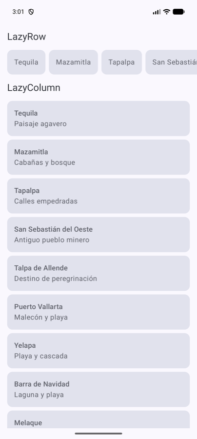
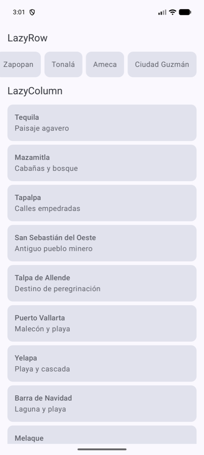
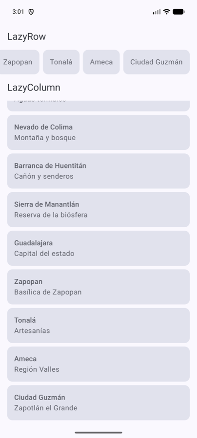

# LazyLayoutsDemo

A4 - Listas dinámicas. App en Jetpack Compose con una `LazyRow` y una `LazyColumn` de 20 elementos.

## Investigación

**LazyColumn y LazyRow:** muestran listas vertical y horizontal. A diferencia de `Column` y `Row`, solo componen los elementos visibles.

- `items`: agrega los elementos de la lista.
- `key`: identifica cada elemento.
- `contentPadding`: espacio alrededor del contenido.
- `Arrangement.spacedBy`: espacio entre elementos.

**data class:** clase de Kotlin para guardar datos. Genera `equals`, `hashCode`, `toString`, `componentN` y `copy`.

## Capturas

| Inicio | LazyRow | LazyColumn |
|---|---|---|
|  |  |  |

## Fuentes

- https://developer.android.com/develop/ui/compose/lists
- https://kotlinlang.org/docs/data-classes.html
