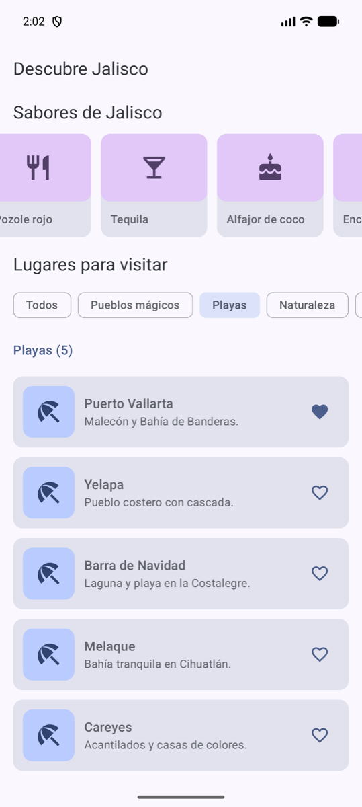
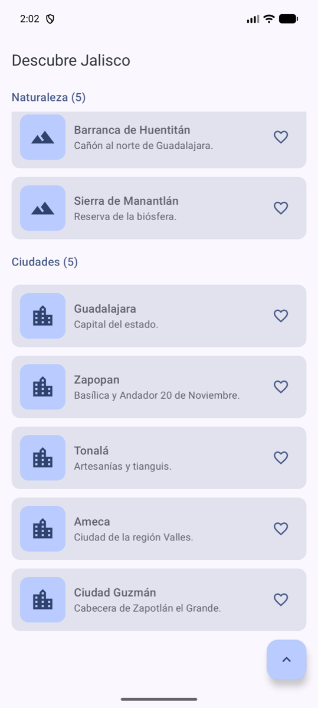

# LazyLayoutsDemo

Actividad **A4 - Listas dinámicas**. App en Jetpack Compose que muestra dos colecciones con `LazyColumn` y `LazyRow`:

- **LazyColumn**: 20 lugares de Jalisco agrupados por categoría, con encabezados fijos.
- **LazyRow**: 15 platillos y bebidas, y una segunda fila con los filtros por categoría.

| Inicio | Filtro y favorito | Scroll con encabezado fijo |
|---|---|---|
|  |  |  |

## Investigación

### LazyColumn y LazyRow

`Column` y `Row` componen y miden todos sus hijos, se vean o no. `LazyColumn` (vertical) y `LazyRow` (horizontal) solo componen y miden los elementos visibles en pantalla, por eso convienen para listas largas.

Su contenido no es un bloque `@Composable` normal, sino un bloque `LazyListScope` donde se describen los elementos:

| Función | Uso | Dónde se usa aquí |
|---|---|---|
| `item { }` | Un solo elemento | Títulos, fila de platillos, chip "Todos" |
| `items(lista) { }` | Un elemento por dato | Lugares, platillos, filtros |
| `itemsIndexed(lista) { i, x -> }` | Igual, con el índice | No se necesitó |
| `stickyHeader { }` | Encabezado que queda fijo | Nombre de la categoría |

Parámetros y modificadores importantes:

- **`contentPadding`**: espacio alrededor del *contenido*. A diferencia de `Modifier.padding`, se desplaza con la lista, así que los elementos no se cortan en el borde.
- **`verticalArrangement` / `horizontalArrangement`** con `Arrangement.spacedBy()`: separación entre elementos.
- **`key`**: identificador único y estable. Sin él, el estado se asocia a la posición y se pierde al filtrar o reordenar. Debe ser un tipo que acepte `Bundle`.
- **`contentType`**: Compose reutiliza composiciones solo entre elementos del mismo tipo.
- **`state` (`rememberLazyListState`)**: permite leer la posición y desplazarse con `animateScrollToItem()`.
- **`derivedStateOf`**: evita recomponer en cada píxel de scroll; solo se recompone cuando cambia el resultado.
- **`Modifier.animateItem()`**: anima elementos que entran, salen o se mueven. Requiere `key`.

Se puede poner una `LazyRow` dentro de una `LazyColumn` porque se desplazan en direcciones distintas. Anidar dos listas en la **misma** dirección sin tamaño fijo lanza una excepción.

### Modelo de datos (`data class`)

Una `data class` es una clase pensada para guardar datos:

```kotlin
data class Lugar(
    val id: Int,
    val nombre: String,
    val descripcion: String,
    val categoria: Categoria
)
```

- **Requisitos**: al menos un parámetro en el constructor primario, todos con `val` o `var`; no puede ser `abstract`, `open`, `sealed` ni `inner`.
- **Genera automáticamente**: `equals()`, `hashCode()`, `toString()`, `componentN()` y `copy()`.
- Esas funciones solo consideran las propiedades del constructor primario.
- `copy()` hace una copia superficial: `lugar.copy(nombre = "Otro")`.
- **Con Compose**: usar `val` la hace inmutable, y `equals()` por contenido permite omitir la recomposición de elementos que no cambiaron.

## Estructura

```
app/src/main/java/com/example/lazylayoutsdemo/
├── MainActivity.kt
├── data/
│   ├── Lugar.kt        data class de la LazyColumn
│   ├── Platillo.kt     data class de la LazyRow
│   └── DatosDemo.kt    colecciones de ejemplo
└── ui/
    ├── PantallaListas.kt   LazyColumn, LazyRow y estado
    ├── Tarjetas.kt         diseño de cada elemento
    └── theme/
```

## Verificación

Probado en un emulador Pixel 9 Pro XL (API 37):

- Scroll vertical y horizontal hasta el último elemento, sin cierres inesperados.
- Los filtros actualizan la lista; el filtro y los favoritos se conservan al rotar.
- El botón flotante aparece al bajar y regresa al inicio.
- Pruebas unitarias: `./gradlew testDebugUnitTest` (3 pruebas).

Frames lentos al desplazar (`adb shell dumpsys gfxinfo`), emulador con GPU del equipo:

| App | Frames lentos | Mediana por frame |
|---|---|---|
| LazyLayoutsDemo (release con R8, 3 corridas) | 25 % – 51 % | 18 – 40 ms |
| Ajustes de Android (referencia, 2 corridas) | 42 % – 53 % | 32 – 36 ms |

El emulador es lento incluso con una app del sistema, por lo que estos números no representan un teléfono. La fluidez se debe confirmar en un dispositivo físico con el build release.

## Fuentes

- [Listas y cuadrículas - Android Developers](https://developer.android.com/develop/ui/compose/lists)
- [Prácticas de rendimiento en Compose - Android Developers](https://developer.android.com/develop/ui/compose/performance/bestpractices)
- [Data classes - Kotlin](https://kotlinlang.org/docs/data-classes.html)
